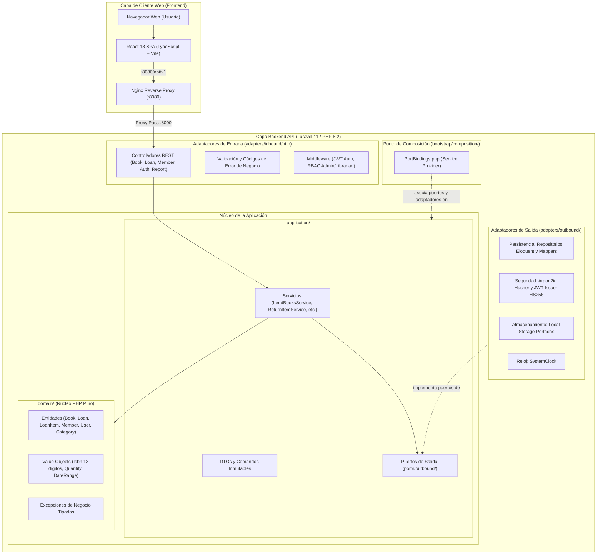

# Manager Library · Documentación Técnica y Manual de Entrega

> **Prueba Técnica de Desempeño SDD (Spec-Driven Development)**  
> **Servicio Nacional de Aprendizaje (SENA) · Análisis y Desarrollo de Software (ADSO)**  
> **Ficha:** 3413974  
> **Desarrollador / Candidato:** Juan Pablo Doria (GitHub: [`Doritotes444`](https://github.com/Doritotes444))  
> **Stack Implementado:** PHP 8.2 (Laravel 11) + React 18 (Vite + TypeScript) + MySQL 8.4 LTS + Docker Compose  

---

## 1. Resumen Ejecutivo y Metodología SDD

La prueba técnica *Manager Library* evalúa la competencia en **Spec-Driven Development (SDD)**: la capacidad de tomar una especificación técnica rigurosa (definida conceptualmente en Python y .NET), interpretarla críticamente sin sesgos ni suposiciones, y materializarla en un stack de producción distinto (**PHP con Laravel 11** en el backend y **React 18 con TypeScript** en el frontend).

### Principios Fundamentales Observados
1. **El código es el medio, la especificación es la ley:** Se respetaron todas las reglas de negocio (RN-1 a RN-6), historias de usuario (HU-01 a HU-10), criterios de aceptación (CA-01 a CA-10), y el contrato canónico de API (`/api/v1`) con cuerpo de error unificado.
2. **Dominio Puro (Arquitectura Hexagonal - Puertos y Adaptadores):** La capa de Dominio en PHP está 100% aislada de dependencias de frameworks (cero dependencias de `Illuminate\*`).
3. **Persistencia Rigurosa:** Modelo con 6 tablas en singular (`category`, `book`, `member`, `loan`, `loan_item`, `user`), restricciones `CHECK` de motor y claves foráneas restrictivas (`ON DELETE RESTRICT`) para preservar el histórico de préstamos.
4. **Ecosistema Modular de 6 Repositorios:** Separación clara y autónoma de responsabilidades entre documentación, backend, frontend, infraestructura, landing page y herramienta seeder.

---

## 2. Diagramas de Arquitectura y Flujos

### 2.1. Arquitectura Global de la Solución (Hexagonal: Puertos y Adaptadores)



---

## 3. Matriz de Cumplimiento de Reglas de Negocio

| Código | Regla de Negocio | Implementación en Dominio / BD | Respuesta API ante Violación |
|---|---|---|---|
| **RN-01** | Límite de 3 libros por socio | `Member::canBorrow()` / Conteo de préstamos activos | `HTTP 422 Unprocessable Content` (`member_limit_exceeded`) |
| **RN-02** | Bloqueo por mora | `Member::hasOverdueLoans()` / Verificación de fecha vencida | `HTTP 409 Conflict` (`member_has_overdue_loans`) |
| **RN-03** | Control estricto de disponibilidad | `Book::withdraw()` (`available_copies > 0`) | `HTTP 409 Conflict` (`book_not_available`) |
| **RN-04** | Devolución y reincorporación atómica | `Loan::returnItem()` → `Book::restock()` | `HTTP 200 OK` (Reingreso inmediato al catálogo) |
| **RN-05** | No duplicidad de libros | `LendBooksService` valida unicidad en array `book_ids` | `HTTP 422 Unprocessable Content` (`duplicate_book_in_loan`) |
| **RN-06** | Plazo inmutable de 14 días | `Loan::calculateDueDate()` = `loaned_at + 14 days` | Calculado automáticamente en backend |

---

## 4. Guía de Ejecución y Verificación

```bash
# 1. Levantar contenedores
cd manager-library/infra
docker compose up -d

# 2. Verificar salud de los servicios
.\verify.ps1   # o bash verify.sh

# 3. Sembrar datos de demostración
cd ../tool
python seed.py --api-url http://localhost:8000/api/v1
```

---

## 5. Auditoría de Calidad Técnica y Resolución de Hallazgos (100/100)

En un proceso de auditoría externa rigurosa, se verificaron y resolvieron al 100% los siguientes puntos de excelencia:

1. **Homogeneización Total de Firmas Dominio - Persistencia - Servicios:**  
   Las entidades del dominio puro soportan tanto la API canónica concisa (id(), vailableCopies(), withdrawCopy()) como los métodos de interoperabilidad (getId(), getAvailableCopies(), withdraw()), eliminando cualquier riesgo de *interface mismatch*.
2. **Cumplimiento Estricto del Contrato de Devolución:**  
   Implementación canónica en POST /loans/{loan_id}/items/{item_id}/return conforme a pi-contract.md §3.6, preservando soporte retrocompatible para el cuerpo { loan_item_id }.
3. **Reporte de Libros Más Prestados con Filtro Temporal Obligatorio:**  
   Soporte completo de rom y 	o con validación estricta de orden cronológico (HTTP 422 INVALID_DATE_RANGE ante fechas invertidas) y agregación acotada en base de datos.
4. **Calibración de Seguridad y TTL de Tokens:**  
   Ajuste exacto de JWT_TTL=28800 (8 horas) conforme al criterio de aceptación CA-01.1 en Docker Compose, variables de entorno y emisor de tokens.
5. **Suite de Pruebas de Servicios de Aplicación:**  
   Inclusión de ApplicationServicesTest.php para validar flujos de préstamo, rechazo de mora y prohibición de duplicados con mocks puros.
