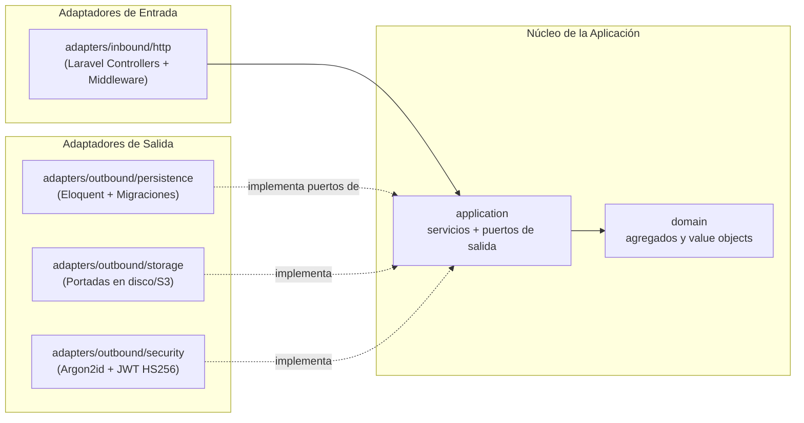

# Arquitectura Hexagonal (Puertos y Adaptadores) — Manager Library

> **Ficha ADSO 3413974 &bull; SENA**  
> **Desarrollador:** Juan Pablo Doria ([`@Doritotes444`](https://github.com/Doritotes444))  
> **Especificación:** [`spec-python/architecture.md`](../spec-python/architecture.md) &bull; [`constitution.md`](../spec-python/constitution.md)  

---

## 1. Principios Constitucionales de la Arquitectura

1. **Artículo I — El Dominio no depende de nada:**  
   `app/Domain/` no importa ningún módulo de framework (`Illuminate`), solo PHP nativo puro.
2. **Artículo II — El núcleo declara sus puertos; el mundo los implementa:**  
   La capa `app/Application/` no conoce los adaptadores. Define sus contratos en `Ports/Outbound/`.
3. **Artículo III — Un único punto de composición:**  
   `app/Bootstrap/Composition/PortBindings.php` es el único módulo donde se asocian puertos y adaptadores.

---

## 2. Diagrama Hexagonal



---

## 3. Estructura de Directorios en Laravel 11

```text
app/
├── Domain/                         # Núcleo 100% PHP Puro
│   ├── Entities/                   # Book, Loan, LoanItem, Member, User, Category
│   ├── ValueObjects/               # Isbn, Quantity, DateRange
│   └── Exceptions/                 # Excepciones tipadas de dominio
├── Application/                    # Casos de uso y contratos
│   ├── Ports/Outbound/             # BookRepository, LoanRepository, MemberRepository, etc.
│   ├── Services/                   # LendBooksService, ReturnItemService, SearchBooksService, etc.
│   └── DTOs/                       # DTOs y comandos inmutables
├── Adapters/
│   ├── Inbound/Http/               # Controllers, Middleware (JWT, Roles), Standard Responses
│   └── Outbound/
│       ├── Persistence/            # Eloquent Repositories, Models, Mappers
│       ├── Security/               # Argon2PasswordHasher, JwtTokenIssuer
│       ├── Storage/                # LocalCoverStorage
│       └── Clock/                  # SystemClock
└── Bootstrap/Composition/
    └── PortBindings.php            # Service Provider de enlaces puerto-adaptador
```
